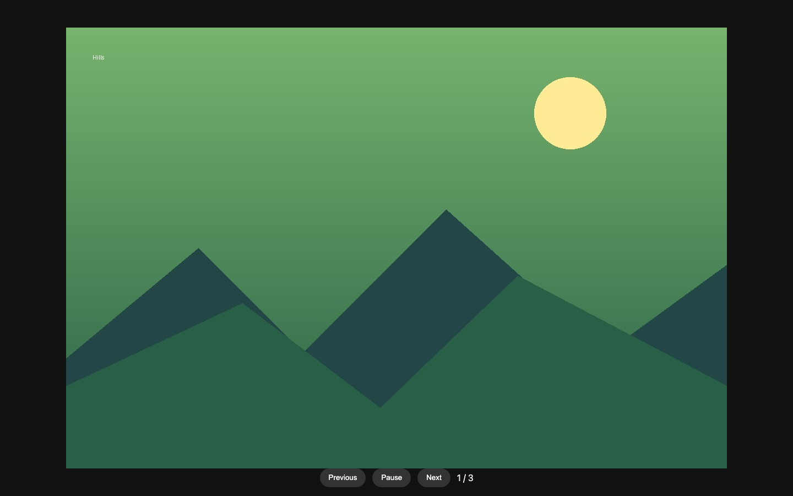

# Simple Slideshow

A small, local photo slideshow with an optional cleanup step for scanned or photographed prints.



## 1. Install

```bash
python3 -m venv .venv
source .venv/bin/activate
pip install -r requirements.txt
```

## 2. Add photos

Put the photos you want to show in `photos/`. The folder is intentionally ignored by Git, so personal photos stay on your computer.

## 3. Clean up photographed prints (optional)

This detects a light print border, crops it, and applies a restrained contrast and sharpness correction. It writes cleaned copies to `cleaned-photos/` and leaves the originals untouched.

```bash
python clean_photos.py
```

To use a different folder:

```bash
python clean_photos.py --input photos --output cleaned-photos
```

If the cleanup result looks right, replace the slideshow input with the cleaned folder:

```bash
rm -rf photos
mv cleaned-photos photos
```

## 4. Run the slideshow

```bash
python slideshow.py
```

Open [http://127.0.0.1:8765](http://127.0.0.1:8765). Use the controls or press the spacebar to pause and resume. Press `F` for fullscreen.

The server reads the photo folder when the page loads, so add or remove photos and refresh the browser to update it.

## Privacy

Personal photos and generated files are excluded by `.gitignore`. Before publishing changes, check `git status` and confirm that only source files and documentation are staged.
